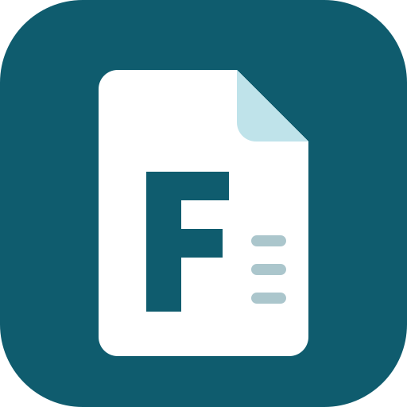

<p align="center"></p>

# faktura

> ## ⚠ Haftungsausschluss
>
> **faktura wird ohne Gewähr bereitgestellt.** Die Software ist keine Rechts-, Steuer- oder Buchhaltungsberatung und ersetzt keine
> Prüfung durch eine Steuerberatung. Es wird **keine Garantie** für die Konformität mit GoBD, Steuerrecht oder E-Rechnungs-Vorgaben
> (ZUGFeRD/EN 16931) übernommen. **Der Betrieb erfolgt auf eigenes Risiko.** Sie sind selbst verantwortlich für die Prüfung jeder
> Rechnung, die Aufbewahrung, Backups, die Sicherheit des Betriebs und die Einhaltung Ihrer gesetzlichen Pflichten.
>
> **English:** faktura is provided "as is", without warranty of any kind. It is not legal, tax or accounting advice and does not
> guarantee compliance with GoBD, tax law or e-invoicing rules. You run it at your own risk and are responsible for checking every
> invoice, retention, backups, secure operation and legal compliance. See [LICENSE](LICENSE) (Apache-2.0).

**English summary:** faktura is a small, self-hosted invoicing application for German side businesses and small companies
(Java, Spring Boot, SQLite/PostgreSQL). It supports small-business (§ 19 UStG) and regular VAT, GoBD-minded immutable invoices,
gapless numbering, ZUGFeRD e-invoices (EN 16931), offers, dunning, recurring invoices and mail dispatch. The user interface and the
user documentation are in German.

Kleine, selbst betriebene Rechnungssoftware für ein Nebengewerbe oder Kleinunternehmen: Kunden, Leistungskatalog, Rechnungen und
Angebote, Wiedervorlagen (wiederkehrende Rechnungen), Mahnwesen, ZUGFeRD-E-Rechnung und Girocode.

## Funktionen

- Unternehmensstammdaten und **Steuerprofil** mit Gültigkeitszeitraum: Kleinunternehmer (§ 19 UStG) oder Regelbesteuerung, ohne Code-Verzweigung
- Kunden mit Ansprechpartnern, Leistungskatalog mit Einheiten, Versandarten
- **Rechnungen**: Positionen aus dem Katalog oder als Freitext, Positions- und Gesamtrabatt, Versandkosten, Kundenreferenz, Prüfdialog vor dem Finalisieren
- **Unveränderliche Belege (GoBD-orientiert)**: Nummer, Snapshots, Summen, PDF/A mit SHA-256 beim Finalisieren; Korrektur nur über Storno-Beleg
- Konfigurierbare **Nummernkreise** (z. B. `RE{jahr}{#####}`), lückenlos, je Belegart
- **ZUGFeRD-E-Rechnung** (EN 16931, Validierung mit Mustang) je Kunde, **Girocode** (EPC-QR) auf der Rechnung
- **Angebote** mit Gültigkeit und Übernahme in eine Rechnung
- Zahlungseingänge, berechneter Zahlungsstand, **Mahnwesen** mit Stufen (Gebühren und Zinsen optional)
- **Wiedervorlagen**: wiederkehrende Rechnungen im Voraus, erzeugt als Entwurf zur Freigabe
- **Mailversand** von Belegen an Kunden (nur auf ausdrückliche Aktion) und tägliche Hinweis-Mail an den Betreiber
- CSV-Export für die Buchhaltung, Backup und Archivprüfung, optionaler Export-Ordner für ein Dokumentenarchiv (z. B. ecoDMS)
- Anmeldung zuschaltbar (keine / Formular / Proxy-Header / Proxy-Header mit Admin-Formular), mehrere Benutzer, CSRF-Schutz und strenge Content-Security-Policy

## Was faktura ausdrücklich nicht ist

- **Keine Buchhaltung**: keine EÜR, keine Bilanz, kein DATEV-Export (der CSV-Export ist nur eine Lesesicht auf Rechnungen und Zahlungen)
- **Keine Steuer- oder Rechtsberatung** und keine Zusicherung der Konformität
- Kein Lager- und Bestellwesen, kein Bankabgleich, keine Online-Zahlung
- **Keine Rollen- und Rechteverwaltung, keine Mandanten**: ein Unternehmen, alle Benutzer dürfen alles (außer Benutzer verwalten)
- Keine Fremdwährungen, keine mehrsprachigen Belege (Oberfläche und Belege sind deutsch, Währung EUR)
- **Kein automatischer Versand an Kunden**: Belege gehen nur auf ausdrückliche Aktion in den Versanddialog; Wiedervorlagen erzeugen nur Entwürfe
- Kein Datenimport aus anderer Software (nur über eigene Skripte gegen das Schema)

## Sicherheitshinweis zum Betrieb

Der Standardmodus `SECURITY_MODE=NONE` hat **keine Anmeldung**. Er ist nur sicher hinter einem Reverse Proxy, der jeden Zugriff
authentifiziert und den Port abschirmt. **Ohne solchen Proxy `SECURITY_MODE=FORM` setzen** und HTTPS verwenden. Die Anwendung gehört
nie ungeschützt ins Internet. Datenbank, Archiv, Backups und Exporte enthalten Personendaten (Kundenname, Anschrift, Beträge):
Backups verschlüsseln, Zugriff begrenzen, DSGVO und Aufbewahrungsfristen beachten. Details: [docs/betrieb.md](docs/betrieb.md).

## Voraussetzungen

- Docker mit Compose (empfohlen), **oder** Java 25 und Maven (der Wrapper `./mvnw` liegt bei)
- Für die Entwicklung mit Mail-Catcher: Docker (Mailpit)

## Schnellstart

Mit Docker Compose und dem fertigen Image aus der GitHub Container Registry (mit Anmeldung per Formular, kein Klonen und kein Bauen nötig):

```bash
mkdir faktura && cd faktura
curl -fsSLO https://raw.githubusercontent.com/cgoIT/faktura/main/docker-compose.yml
curl -fsSL https://raw.githubusercontent.com/cgoIT/faktura/main/.env.example -o .env
# Pflicht in .env: SECURITY_ADMIN_PASSWORD (mind. 12 Zeichen) eintragen, Modus ist FORM
mkdir -p data && sudo chown 10001:10001 data
docker compose up -d
```

Danach erreichbar unter <http://127.0.0.1:8080> (Port nur an localhost gebunden; für den Zugriff von außen Reverse Proxy mit TLS davorsetzen).

Aus dem Quelltext:

```bash
./mvnw spring-boot:run     # http://localhost:8090 (nur an 127.0.0.1 gebunden, SERVER_ADDRESS ändert das), Datenbank ./data/faktura.db (SQLite)
```

Zum Ausprobieren mit erfundenen Testdaten und Mail-Catcher (nichts verlässt den Rechner; setzt die Datenbank `./data/dev.db` bei jedem Start zurück):

```bash
./mvnw spring-boot:run -Dspring-boot.run.profiles=dev
```

Erste Schritte in der Oberfläche: [Benutzerhandbuch](docs/handbuch.md).

## Dokumentation

| Datei | Inhalt |
| --- | --- |
| [docs/handbuch.md](docs/handbuch.md) | Benutzerhandbuch |
| [docs/betrieb.md](docs/betrieb.md) | Installation, Konfiguration, Reverse Proxy, Anmeldung, Backup, Update |
| [docs/architektur.md](docs/architektur.md) | Stack, Module, Querschnittsthemen |
| [docs/codestil.md](docs/codestil.md) | Codestil |

## Entwicklung und Beiträge

`./mvnw verify` baut und testet alles (SQLite; die PostgreSQL-Tests brauchen Docker). Siehe [CONTRIBUTING.md](CONTRIBUTING.md) und
[SECURITY.md](SECURITY.md). Bitte in Issues und Pull Requests **keine echten Kundendaten** posten.

## Lizenz

[Apache License 2.0](LICENSE), Copyright 2026 cgoIT. Enthaltene Drittsoftware und Schriften: [THIRD-PARTY-NOTICES.md](THIRD-PARTY-NOTICES.md).
